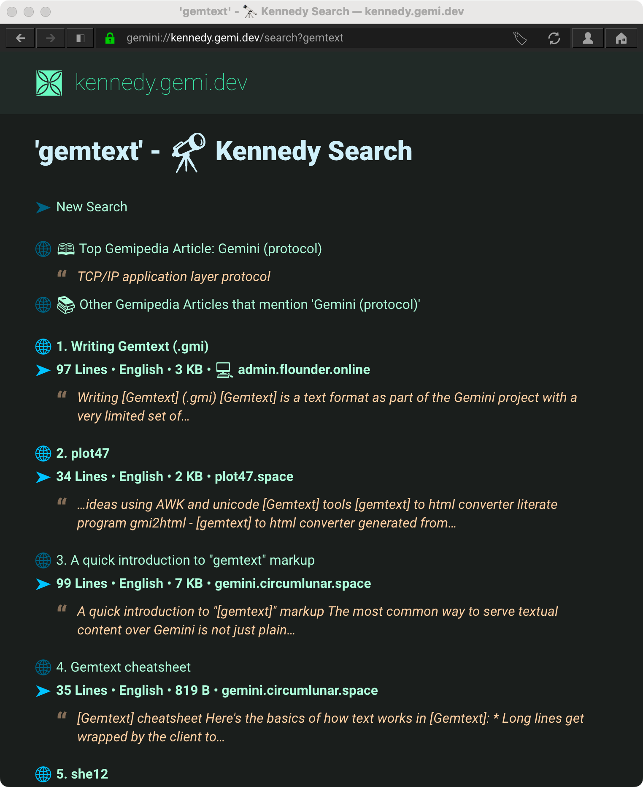

# Kennedy
Kennedy is a search engine for [Gemini space](https://en.wikipedia.org/wiki/Gemini_(protocol)). It consists of a crawler, backend, and Gemini app server. Kennedy leverages many of the techniques and architecture from early WWW crawlers and search engines like Mercator, Archive.org, and GoogleBot.



## Demo
Visit `gemini://kennedy.gemi.dev` with a [Gemini client](https://github.com/kr1sp1n/awesome-gemini) or [via an HTTP-to-Gemini proxy](https://portal.mozz.us/gemini/kennedy.gemi.dev)

## Features
* Full Text search, with Porter Stemming
* Suggested queries. Kennedy recommends other queries if you don't get many results
* Complex search queries. For example: "cats AND dogs", "(cats OR dogs) NOT birds".
* Image Search! Kennedy indexes link text and path info to enable searching for images.
* Content language classification using ngrams instead of MIME types `lang=` parameters
* PageRank-dervied algorithm to better determine results relevance 
* Clean Snippets: Search results include a snippet of content which matches your query. Your keywords are [surrounded] with brackets, and gemtext formatting is removed to make it cleaner to read.
* Lines count: To help you sort quick articles from longer form content, search results tell you how many lines are in the content. If you want to be nerdy, I also include byte sizes.


## Server smoke test

`Kennedy.SmokeTests` is a small C# console app using Gemini.Net to make real TLS Gemini requests. It builds with the solution and runs separately against an existing Kennedy2 database. It does not import WARCs, index content, or change the schema.

Start a temporary Kennedy server on an available high port using a copy of your server settings:

```sh
dotnet run --project Kennedy.SmokeTests -- --settings /path/to/server.json
```

The settings supply the existing data directory, public root, certificate, and key. Paths relative to that settings file are resolved before starting the server. The runner overrides the host/port in its temporary settings and stops the server when it finishes, including on Ctrl+C. Your original settings are preserved. Use `--port 1966` to select a high port explicitly, or `--server /path/to/Kennedy.Server.dll` to check another build.

To check an already running server:

```sh
dotnet run --project Kennedy.SmokeTests -- --base-url gemini://localhost:1966/
```

Checks cover the home page, text and image searches for `cat` with at least one result, Page Info, capsule health, backlinks, robots.txt checker, certificate checker, URL checker, stats, and the known-capsule/security.txt/favicon lists. Error pages are failures even if they carry status 20. Checks continue after individual failures.

By default, tools are submitted `gemi.dev` / `gemini://gemi.dev/`. Use `--capsule example.org --url gemini://example.org/known-page.gmi` for another capsule and URL that exist in your index. The robots, certificate, and URL checkers contact that target, so those checks require network access and an available target with a successful robots.txt response. `--skip-network-tools` skips those three checks and reports them as skipped.

Every run prints its output directory and saves the responses, local server log, and `summary.json`. Use `--output /path/to/results` to choose the directory. Exit codes are 0 for all selected checks passing, 1 for failed checks, 2 for setup errors, and 130 for cancellation. `--help` lists all options. Normal builds compile the runner without executing it.

## Why?
>Many years ago the great British explorer George Mallory, who was to die on Mount Everest, was asked why did he want to climb it. He said, "Because it is there."

[John F. Kennedy Address at Rice University, Sept. 12, 1962](https://www.rice.edu/kennedy)

## Projects
- **Kennedy.Crawler** - Crawler logic (Url Frontiers, Queues, etc)
- **Kennedy.CrawlData** - Models and storage systems for documents, meta data, and full text search
- **Kennedy.Server** - Gemini Server to handle queries and search results. Built on top of [RocketForce](https://github.com/acidus99/RocketForce), a .NET Gemini server and application framework
- **Kennedy.SearchConsole** - Console app for running FTS queries. Used for testing
